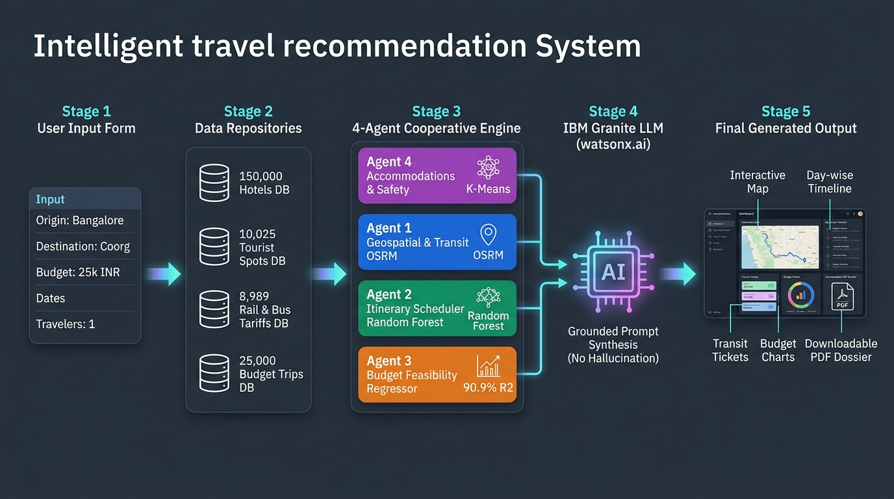
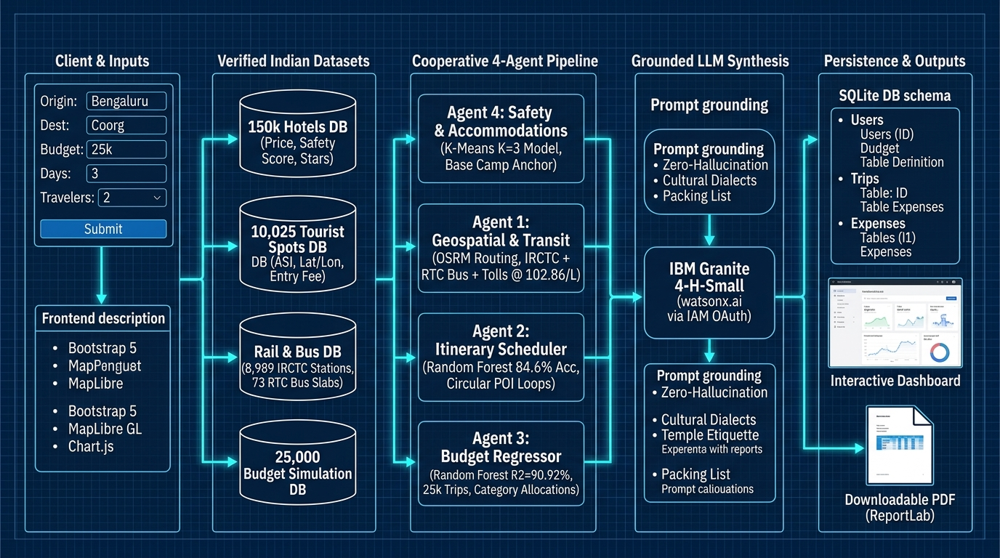
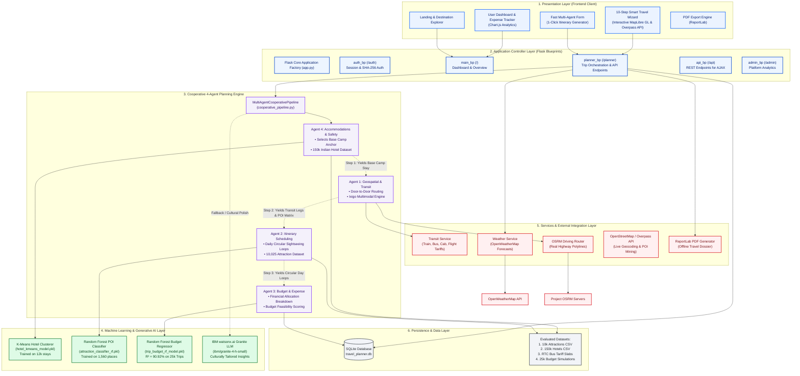
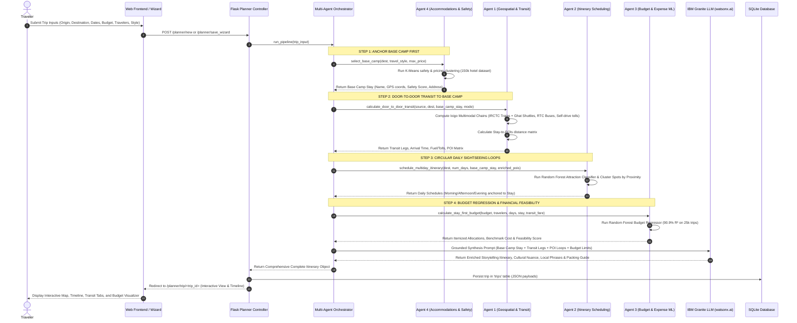
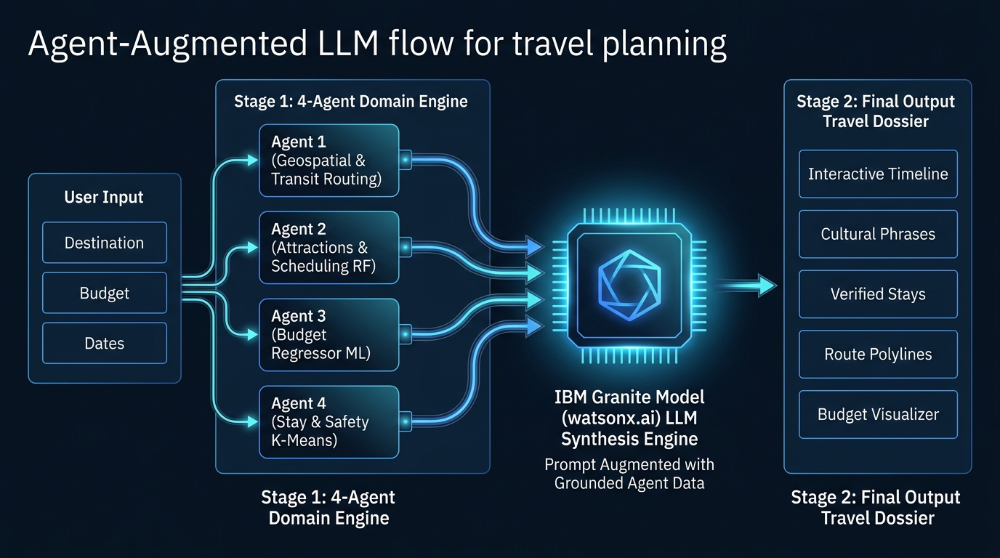
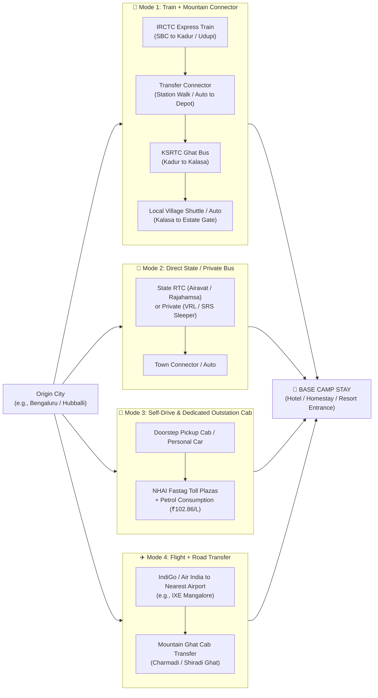
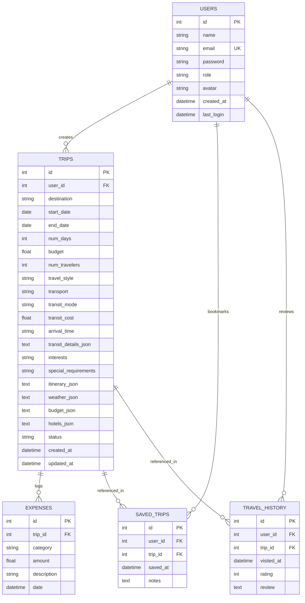

# System Architecture & Technical Specifications
## TravelPlannerAgent — Cooperative Multi-Agent Travel Planning System

---

## 1. System Overview & Core Philosophy

The **TravelPlannerAgent** is a production-grade full-stack travel planning platform tailored for Indian tourism. Unlike traditional generic travel tools that plan trips to abstract city borders, this system is built on the **"Stay-First Anchor" (Base Camp)** paradigm:

```
Traditional Flow:   Origin ───────> Generic City Center ───────> Where do I sleep? ───────> Random POIs
Stay-First Flow:    Origin ───────> Base Camp Stay (Hotel/Homestay) ───────> Circular Daily Loops ───> Return to Stay
```

### Core Tenets:
1. **Base Camp Selection First (Agent 4):** A verified hotel, resort, or homestay is anchored first using K-Means safety and budget clustering from a 150,000+ Indian hotel dataset.
2. **Door-to-Door Multimodal Transit (Agent 1):** Transit is computed from the traveler's doorstep directly to the gate of the Base Camp stay—incorporating trains, connecting ghat shuttles, state RTC buses, toll estimations, and mountain transfers.
3. **Circular Daily Sightseeing Loops (Agent 2):** Daily itineraries depart from and return to the Base Camp each morning and evening without back-and-forth backtracking.
4. **Machine Learning Budget Feasibility (Agent 3):** Trip expenses are benchmarked against a trained Random Forest Regressor ($R^2 = 90.92\%$) trained on 25,000 trips.
5. **Generative AI Synthesis:** IBM watsonx.ai (**IBM Granite** `ibm/granite-4-h-small`) provides culturally rich itineraries, local customs, and regional advice.

---

## 2. End-to-End Data Flow & Architecture Diagram

### 5-Stage Data Flow (Input ➔ Datasets ➔ 4 Agents ➔ IBM Granite LLM ➔ Output Dossier)



### Comprehensive Technical Blueprint & Subsystem Data Flow



*This blueprint highlights the exact datasets, ML algorithms (K-Means, Random Forest Classifier, Random Forest Regressor R²=90.92%), Grounded IBM Granite prompt assembly, and database persistence schemas.*

---


## 3. High-Level Layered Architecture Diagram




---

## 3. Cooperative Multi-Agent Execution Sequence

The cooperative multi-agent pipeline coordinates four specialized AI agents in a strictly orchestrated dependency graph:



---

## 4. Agent-Augmented LLM Flow (IBM Granite on watsonx.ai)

### The Neuro-Symbolic / Compound AI Pattern

A critical differentiator of this project is that **the 4 Specialized Agents feed their computed outputs directly as grounded context into the IBM Granite model**:



### Why This Architecture Eliminates Hallucination:
1. **Traditional Monolithic LLM (Prone to Failure):**
   * Prompting an LLM with only *"Plan a 3-day trip to Samse with ₹20,000"* causes it to invent non-existent hotels, guess inaccurate train tickets, and combine attractions that are hours apart.
2. **Our Agent-Augmented Pattern (Grounded & Deterministic):**
   * **Agent 4** supplies the verified hotel name, safety score (9.6/10), and nightly rate.
   * **Agent 1** supplies exact IRCTC train numbers, connecting KSRTC buses, and road toll distances.
   * **Agent 2** supplies real attraction names from the 10,025 ASI dataset arranged in circular loops.
   * **Agent 3** supplies the ML-predicted cost ($R^2 = 90.92\%$) and itemized category limits.
   * **IBM Granite (`ibm/granite-4-h-small`)** receives this rich structured payload and performs what LLMs do best: **Generative Cultural Synthesis**, crafting localized phrases, temple etiquette, weather-driven packing advice, and day-wise travel narratives without having to guess numbers or locations.

---

## 5. Multimodal Transit Engine Architecture (Ixigo-Style)


Transit does not stop at a generic bus station or rail terminal. It connects the origin all the way to the hotel doorway:



---

## 5. Database Entity-Relationship (ER) Diagram

The SQLite database (`travel_planner.db`) provides persistence for user profiles, trip records, expenses, and reviews:



---

## 6. Machine Learning Models Specification

| Model Name | Type | Architecture / Estimator | Dataset Used | Benchmark Accuracy / Metric | Purpose |
| :--- | :--- | :--- | :--- | :--- | :--- |
| **Trip Budget Regressor** | Supervised Regression | `RandomForestRegressor(n_estimators=100, max_depth=16)` + `MLPRegressor` | 25,000 Simulated Indian Trips | **$R^2 = 0.9092$ (90.92%)**, MAE = ₹1,120 | Accurately predicts total trip cost based on days, travelers, distance, mode, and hotel tier |
| **Attraction Recommendation Classifier** | Multi-class Classification | `RandomForestClassifier(n_estimators=100, max_depth=12)` | 1,560 Indian Tourist Attractions | **Accuracy = 84.6%** | Classifies and tags attraction types (Heritage, Nature, Spiritual, Beach, Adventure) |
| **Hotel Safety & Tier Clusterer** | Unsupervised Clustering | `KMeans(n_clusters=3)` with `StandardScaler` | 12,000 Stays (sampled from 150k dataset) | Inertia Convergence | Groups hotels into Budget, Balanced, and Luxury safety tiers |
| **Itinerary Synthesizer** | Generative AI LLM | **IBM Granite** (`ibm/granite-4-h-small`) | Prompt-Engineered Travel Ontology | Low latency via 2-call token caching | Synthesizes packing lists, cultural phrases, local etiquette, and emergency advisories |

---

## 7. How the Application Operates (Step-by-Step User Flow)

1. **User Authentication & Entry:**
   - The user visits `/` and logs in or creates an account via `/auth/login` (passwords hashed using SHA-256 with salts).
2. **Trip Selection & Initialization:**
   - The user enters origin, destination, dates, budget, travelers, and travel style.
   - The user can choose the **Fast 1-Click Multi-Agent Generator** or the **10-Step Interactive Wizard**.
3. **Base Camp Resolution (Agent 4):**
   - The system checks the destination against the 150,000 hotel dataset and selects the top safety-rated accommodation fitting the budget (e.g., *Bella Vista Tea Estate Homestay* in Samse/Kalasa).
4. **Door-to-Door Multimodal Transit (Agent 1):**
   - The transit engine resolves nearby train stations, bus terminals, airports, and road networks.
   - It computes full multi-leg journeys (e.g., Train to Kadur $\rightarrow$ Bus to Kalasa $\rightarrow$ Auto to Estate).
5. **Sightseeing Schedule Loops (Agent 2):**
   - Agent 2 fetches nearby attractions from the 10,025 tourist spots dataset, clusters them by proximity, and assigns them into morning, afternoon, and evening slots departing from and returning to the Base Camp.
6. **Budget Verification (Agent 3):**
   - The budget model verifies whether the user's allocated budget is sufficient, splits it into Stay (35%), Transit (25%), Meals (20%), Activities (12%), and Emergency Buffer (8%), and compares it with the trained ML regression benchmark.
7. **Weather Alerts & Packing Lists:**
   - Real-time weather is fetched via OpenWeatherMap to deliver weather warnings (e.g., monsoon rain gear).
   - Customized packing checklists and emergency contacts (Police: 100, Tourist Helpline: 1363) are prepared.
8. **Interactive Review & Modification:**
   - The user inspects the trip on an interactive MapLibre GL map, adjusts itineraries, and logs expenses.
9. **Export & Offline Use:**
   - The user can download a publication-ready PDF itinerary dossier generated dynamically via ReportLab.
