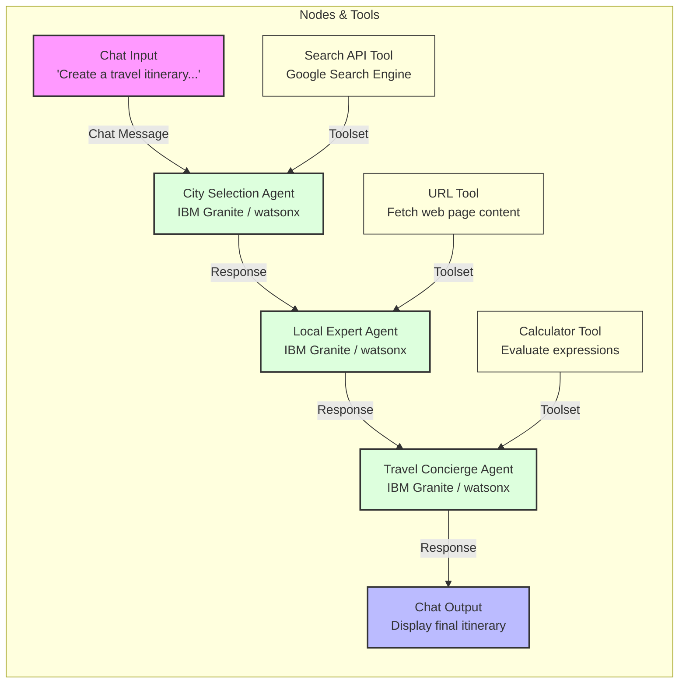
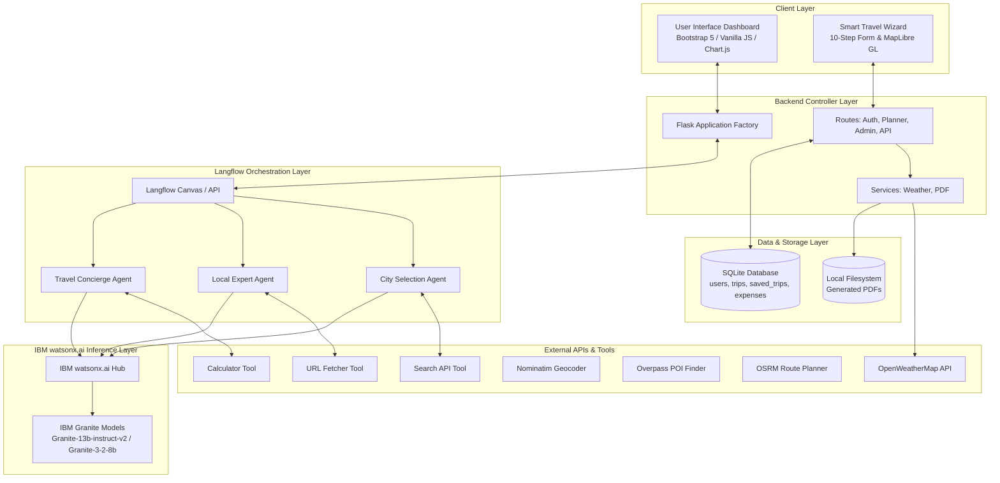

# Project Submission Details

This document contains a slide-by-slide text transcription of the project presentation template: `AICTE_Project Submission Template for EduentFoundation_IBMUniversityEngagement.pptx`.

---

## Slide 1: Title Slide
* **Project Type:** IBM University Engagement Project Submission
* **Topic:** Exploring the Power of Agentic AI with IBM Granite and watsonx.ai
* **Project Title:** AI-Powered Travel Planner Agent

---

## Slide 2: Project Info & Team Details
* **Student Name:** [To be filled]
* **Recent Passport Photo:** [To be placed]
* **Email ID:** [To be filled]
* **Mobile Number [WhatsApp]:** [To be filled]
* **Domain of Project:** Travel / Tourism
* **Project Title:** AI Travel Planner Agent
* **Recommended Font Styling:**
  * Font Style: Arial
  * Font Size (Heading): 28
  * Font Size (Content): 20

---

## Slide 3: Problem Statement — Travel Planner
* **The Challenge:**
  Planning a vacation or journey can be incredibly stressful and time-consuming. Travelers must visit multiple websites to search for destinations, manually compare hotels, research transport modes, check weather forecasts, calculate budgets, and organize day-by-day activities. Scattered information, a lack of personalization, and manually compiled spreadsheets lead to sub-optimal itineraries and high frustration.
* **The Objective:**
  Build an AI-Powered Travel Planner Agent that delivers personalized itineraries, budget allocations, hotel options, transport guides, and real-time travel details in one unified platform. The solution should include:
  * **Personalized Itineraries:** Generate custom day-wise schedules based on dates, budget constraints, travel styles, and special preferences.
  * **Multi-Modal & Interactive Tools:** Live maps, a drag-and-drop timeline builder, geocoded inputs, and a real-time attraction explorer.
  * **Live Weather Integration:** Display current weather conditions and 7-day forecast for the destination.
  * **Expense Tracker & Analytics:** Log travel expenses, display interactive charts, and calculate remaining budget.
  * **Automated PDF Export:** Generate professional offline-ready travel reports.
  * **Multi-Agent / Modular System:**
    * Itinerary Generation Agent (day-wise scheduling)
    * Budget Planner Agent (expense categories and allocation)
    * Hotel Recommendation Agent (tiered accommodation recommendations)
    * Transport Selection Agent (cost-effective transit route advice)

---

## Slide 4: Proposed Solution — AI-Powered Travel Planner Agent
* The proposed solution is a full-stack, AI-Powered Travel Planner Agent that simplifies journey planning. Built on Flask, SQLite, and custom Bootstrap styling, it features two distinct but connected workflows:
  * **Smart Travel Wizard:** An interactive 10-step planner. It uses Nominatim API for geocoding, Overpass API for discovering nearby tourist spots from OpenStreetMap, OSRM API for road routing and drive-time calculations, MapLibre GL for rendering interactive maps, and Chart.js for real-time budget and time analytics.
  * **IBM Granite AI Planner:** Leverages IBM watsonx.ai REST API and the `ibm/granite-4-h-small` model to generate detailed, structured JSON representations for itineraries, hotel selections, transit options, and budget breakdowns.
* The solution includes a user-friendly dashboard that visualizes trip statistics, shows live weather forecasts, tracks manual travel expenses, and manages saved trips.
* Under the hood, the system uses two optimized API calls to watsonx.ai for fast generation. The first fetches the core itinerary and packing details, while the second retrieves budget allocations and hotel/transport options.
* A clean `@media print` style and a ReportLab PDF generator allow offline PDF/print downloads of the full travel plan.

---

## Slide 5: Technology Used
* **Flask (MVC Framework):** For routing, session management, and server-side rendering.
* **IBM Granite Model:** (e.g., `ibm/granite-4-h-small` / `ibm/granite-13b-instruct-v2`) For natural language reasoning, structured JSON text generation, and personalization.
* **IBM watsonx.ai:** Provides secure REST API access to foundation models and token authentication.
* **MapLibre GL & OpenFreeMap:** For rendering interactive maps, marker plots, and path polylines.
* **Nominatim, Overpass, and OSRM APIs:** For address autocompletion, POI attraction discovery, and driving route distance calculations.
* **Chart.js:** For rendering interactive budget and time distribution charts.

---

## Slide 6: Langflow Components Used
1. **Chat Input:** Receives input query from the Playground, e.g., `"Create a travel itinerary for a trip from Delhi to Mumbai for 5 days with active adventure style"`.
2. **City Selection Agent:**
   * **Model Provider:** IBM watsonx.ai
   * **Model Name:** `ibm/granite-13b-instruct-v2` (or `ibm/granite-3-2-8b`)
   * **Agent Instructions:** `"You are a helpful assistant that can select the best cities/destinations for a trip based on user preferences and constraints."`
   * **Connected Tools:** `Search API`
3. **Search API Tool:** Call the searchapi API with result limiting (e.g. engine: google) to retrieve destination coordinates, attraction lists, and route options.
4. **Local Expert Agent:**
   * **Model Provider:** IBM watsonx.ai
   * **Model Name:** `ibm/granite-13b-instruct-v2` (or `ibm/granite-3-2-8b`)
   * **Agent Instructions:** `"You are a knowledgeable Local Expert who provides detailed guides for selected cities, including top-rated attractions, restaurants, and hidden gems."`
   * **Connected Tools:** `URL`
5. **URL Fetcher Tool:** Fetches content from one or more web pages, following links recursively to obtain detailed descriptions of venues and highlights.
6. **Travel Concierge Agent:**
   * **Model Provider:** IBM watsonx.ai
   * **Model Name:** `ibm/granite-13b-instruct-v2` (or `ibm/granite-3-2-8b`)
   * **Agent Instructions:** `"You are an Amazing Travel Concierge assistant that takes destination details and creates a structured day-by-day itinerary, including budget allocations and transit plans."`
   * **Connected Tools:** `Calculator`
7. **Calculator Tool:** Performs basic arithmetic operations on a given numerical expression to compute distances, budget ratios, hotel tariffs, and entry fees.
8. **Chat Output:** Displays the finished travel itinerary, including day-wise slots, budgets, local guides, and maps.

---

## Slide 7: Langflow Workflow

---

## Slide 8: Architecture Blueprint

---

## Slide 9: Role of Agentic AI in the Solution
* Agentic AI elevates the Travel Planner from a static search system to an autonomous planning assistant. Using IBM watsonx.ai and IBM Granite models, the agent reasons and coordinates the various components of a trip based on user preferences.
* The model acts as a multi-specialist system: automatically dividing total budget percentages (for accommodation, food, transport, activities, etc.), recommending tiered hotels matching the style, selecting transit methods, and building schedules.
* It maintains context awareness by checking travel duration, number of travelers, budget constraints, travel styles (e.g., Adventure, Nature, Solo), and special instructions (e.g. dietary or accessibility rules).
* In the Smart Wizard workflow, agentic design is displayed via automated chaining: resolving geocodes, querying coordinates for tourist spots, calculating driving paths between stops, and presenting a unified day-to-day plan dynamically.

---

## Slide 10: Token Usage
* **Tokens Used:** 1,954 tokens.
* Displays comparisons of context length and token counters:
  * Before Prompt: 0
  * After the Prompt: 1,954
* Token counts are monitored and logged to optimize watsonx.ai inference efficiency.

---

## Slide 11: Novelty and Uniqueness
The proposed Travel Planner Agent combines Agentic AI, real-time geolocational APIs, and offline document processing:
* **Dual-Workflow System:** Features an interactive API-driven Smart Wizard (zero API key dependency) alongside a high-fidelity IBM Granite AI generator.
* **True Geographical Routing:** Utilizes real OpenStreetMap datasets (Overpass/OSRM) to ensure attractions and routes are geographically possible and route-optimized.
* **Comprehensive Dashboard:** Bundles itinerary generation, live weather forecasting, MapLibre GL mapping, and manual expense tracking into a single responsive view.
* **Offline Utility:** Offers print-ready CSS formats and a custom ReportLab PDF exporter for offline itinerary access.
* **Enterprise-Ready Infrastructure:** Scaled with IBM watsonx.ai and secure Granite models, providing reliable JSON outputs and strict safety guidelines.

---

## Slide 12: GitHub Repository Link
* **Required Files in Git Repository:**
  1. `app.py` file (Flask entry point)
  2. `requirements.txt` file (Dependencies)
  3. `PROJECT_STATUS.md` file (Detailed developer documentation)
  4. `project_details.md` file (Presentation transcript details)
  5. Folder structures: `backend/` and `frontend/`
* **Github Repository URL:** [To be pasted]

---

## Slide 13: Future Scope
1. **Collaborative Planning:** Enable multiple users to collaborate on a single travel plan, supporting shared expense logging, real-time activity votes, and unified notes.
2. **Booking Integration:** Connect direct booking widgets for flight, train, and hotel recommendations using Amadeus, Skyscanner, or Booking.com APIs.
3. **Personalized Machine Learning:** Feed user ratings and travel history database records into the AI inference context to suggest highly tailored destinations over time.

---

## Slide 14 & 15: Certificates Earned
* Credly certificate badge link/image.
* IBM BOB Course Certificate badge link/image.

